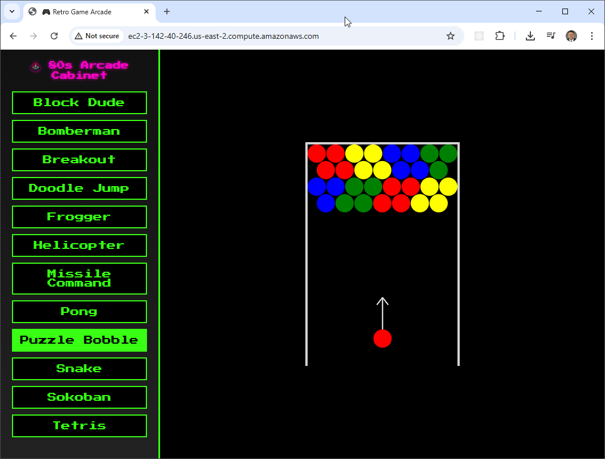
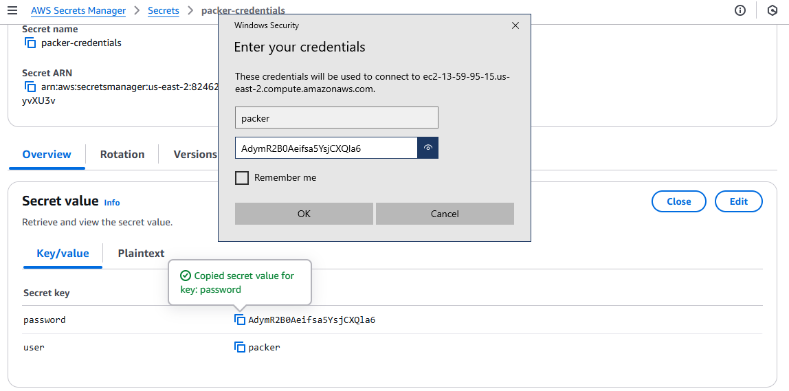
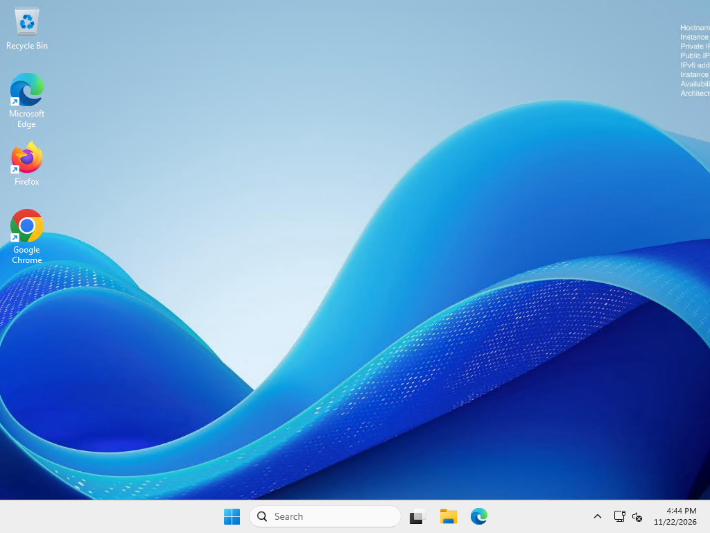

# Building AMIs with EC2 Image Builder on AWS

Two custom images built with **EC2 Image Builder** and deployed with
**Terraform**: a Linux **games** AMI, Ubuntu 24.04 with Apache serving a dozen
retro HTML games, and a Windows **desktop** AMI, Windows Server 2025 with the
latest updates, Chrome and Firefox. Both images carry a local `builder`
account whose password comes from Secrets Manager, and Terraform launches one
server from each.

This is the [aws-packer](https://github.com/mamonaco1973/aws-packer) demo with
a different baker. The images, the scripts and the test servers are the same;
the build runs inside AWS. There is no Packer binary, and no SSH or WinRM
connection to the build instance: Image Builder drives it through **SSM**.



| Piece | Where | Role |
|---|---|---|
| **games AMI** | `games_ami_<build date>` | Ubuntu 24.04 + OS updates + Apache + 12 HTML games, SSM agent enabled, `builder` sudo user |
| **desktop AMI** | `desktop_ami_<build date>` | Windows Server 2025 + Windows updates, Chrome, Firefox, `builder` admin user |
| **games-ec2-instance** | `packer-subnet-1` (us-east-2a) | `t3.micro` from the newest games AMI; HTTP, HTTPS and SSH open |
| **desktop-ec2-instance** | `packer-subnet-2` (us-east-2b) | `t3.medium` from the newest desktop AMI; HTTPS and RDP open |
| **Secrets Manager** | regional | `builder-credentials`: the `builder` user and a generated password |
| **S3 bucket** | regional | `image-builder-scripts-<random>`: the scripts and HTML the builds download |

## Architecture

<picture>
  <source media="(prefers-color-scheme: dark)" srcset="architecture-dark.svg">
  
</picture>

Regenerate with `python3 make_diagram.py`.

- **`01-infrastructure/`**: the VPC (`packer-vpc`, 10.0.0.0/24) with two
  public subnets, the security groups (including the egress-only
  `image-builder-sg` for build instances), and the `builder-credentials`
  secret. The `packer-*` network names are kept from the Packer version.
- **`02-image-builder/`**: pure Terraform. Components, recipes, one shared
  infrastructure configuration, a distribution configuration per AMI, and one
  `aws_imagebuilder_image` per AMI. `terraform apply` blocks until both AMIs
  exist, as `packer build` did.
- **`02-image-builder/linux/`** and **`windows/`**: the same scripts and HTML
  as the Packer version, still the source of truth. Terraform uploads them to
  the S3 bucket and the components pull them with `S3Download`.
- **`03-deploy/`**: unchanged. The two EC2 instances, launched from the newest
  `games_ami*` and `desktop_ami*` images, and their SSM instance profile.

## How the images are built

Each image is a **recipe**: a parent image plus an ordered list of
**components**. A component is a YAML document of steps (`S3Download`,
`ExecuteBash`, `ExecutePowerShell`, `Reboot`, ...) that Image Builder's agent
runs on the build instance through SSM. AWS publishes managed components for
common jobs; this lab uses three of them and adds one of its own per image.

**Linux** (`m5.large` build instance, 16 GB gp3):

1. `update-linux` (AWS-managed) installs every available package update.
2. `aws-cli-version-2-linux` (AWS-managed) installs the AWS CLI, which the
   next step needs and Canonical's image doesn't ship.
3. `games-setup` downloads `html/`, `install.sh` and `config_ssh.sh` from S3,
   installs Apache, which serves the games from `/var/www/html`, and enables
   the SSM agent snap. It then reads the password from Secrets Manager **on
   the build instance** and creates the `builder` user with passwordless sudo.

**Windows** (`m5.large` build instance, 64 GB gp3):

1. `update-windows` (AWS-managed) installs every available Windows update and
   reboots as many times as it needs.
2. `desktop-setup` downloads the PowerShell scripts from S3, reads the
   password from Secrets Manager with AWS Tools for PowerShell, creates the
   `builder` user in Administrators and Remote Desktop Users, places
   `boot.ps1` in `C:\mcloud\`, installs Chrome and Firefox, removes the
   EC2 desktop shortcuts, and turns off the EC2Launch instance-info wallpaper
   (it removes the `setWallpaper` task from EC2Launch's `agent-config.yml`).

Image Builder then snapshots the instance into the AMI, names it from the
distribution configuration (`games_ami_{{ imagebuilder:buildDate }}`), and
terminates the build instance. Both images build in parallel.

### What changed from the Packer version

| Packer | Image Builder |
|---|---|
| `packer build` from your machine | `terraform apply` on `02-image-builder/`; the build runs in AWS |
| SSH (Linux) and WinRM over HTTPS (Windows) into the build instance | SSM; the build security group has **no inbound rules** |
| `bootstrap_win.ps1` set the Administrator password and configured WinRM | **Dropped**: nothing connects to the instance, so there is nothing to set up |
| `apply.sh` read the password and passed it to Packer as a variable | The build instance reads the secret itself with its instance profile; the password is never a component parameter, so it never shows in the console |
| `windows-update` plugin + `windows-restart` | AWS-managed `update-windows` component |
| No OS updates on Linux | AWS-managed `update-linux` component |
| `file` provisioners | Scripts uploaded to S3, `S3Download` steps |
| Explicit `ec2launch reset` and `sysprep` | Not needed; the `boot.log` check in `validate.sh` proves userdata still runs on new instances |
| `packer` user and `packer-credentials` secret | `builder` user and `builder-credentials` secret |

### Versions are immutable

Components and recipes are versioned, and a name and version pair can hold
only one definition. Changing a component's YAML or a recipe means bumping
`build_version` in `02-image-builder/main.tf`. Editing a script in `linux/`
or `windows/` does **not** need a bump: the scripts live in S3, and changing
one re-uploads it and rebuilds that image on the next apply. A newer base AMI
is picked up on the next version bump, or on a fresh apply.

## Security groups

```
internet ─80, 443, 22─▶ games-ec2-instance
internet ─443, 3389──▶ desktop-ec2-instance
build instances ─443─▶ SSM, S3, Secrets Manager, package mirrors (outbound only)
```

The four server groups (`packer-sg-http`, `-https`, `-ssh`, `-rdp`) allow
`0.0.0.0/0`. The games server's user data turns on SSH password logins, so
`builder` can sign in over SSH as well as SSM. Build instances get a public IP
from the subnet and reach AWS through the internet gateway; there are no VPC
endpoints.

## Prerequisites

* [An AWS Account](https://aws.amazon.com/console/)
* [Install AWS CLI](https://docs.aws.amazon.com/cli/latest/userguide/getting-started-install.html)
* [Install Terraform](https://developer.hashicorp.com/terraform/install)
* [Install jq](https://jqlang.github.io/jq/download/)

No Packer install is needed.

If this is your first time watching our content, we recommend starting with
this video: [AWS + Terraform: Easy Setup](https://youtu.be/BCMQo0CB9wk).

## Deploy

```bash
git clone https://github.com/mamonaco1973/aws-image-builder.git
cd aws-image-builder
./apply.sh       # 1: VPC + secret  2: games and desktop AMIs (Image Builder)  3: EC2 instances
```

Everything deploys to `us-east-2`. The Image Builder phase takes the longest,
most of it Windows updates. Each run of `apply.sh` on a fresh lab builds new
AMIs, and phase 3 always uses the newest. `apply.sh` ends by running
`validate.sh`, which also checks that the games page loads and that
`C:\mcloud\boot.log` exists on the Windows server, proving the userdata ran
`boot.ps1`:

```
============================================================================
Image Builder AMIs - Validation Output
============================================================================

NOTE: Games URL:             http://ec2-203-0-113-10.us-east-2.compute.amazonaws.com
NOTE: Games page:            HTTP 200
NOTE: Windows server (RDP):  ec2-203-0-113-20.us-east-2.compute.amazonaws.com
NOTE: Windows boot.log:      NOTE: AMI provisioned boot script ran

NOTE: Builder user:          builder
NOTE: Builder password:      ************************
```

## Try it

1. Open the **Games URL** and pick a game.
2. Get the `builder` password: `validate.sh` prints it, and it is in the
   `builder-credentials` secret.

3. RDP to the **Windows server** as `builder`:

   

   

## Troubleshooting

| Symptom | Fix |
|---|---|
| A build fails | Open **EC2 Image Builder > Images** in the console, or the `/aws/imagebuilder/<recipe>` log group in CloudWatch. Each step's output is there. The build instance is terminated on failure. |
| A build sits in "Building" with no progress | The instance can't reach SSM. It needs its public IP (the subnet assigns one) and outbound 443. |
| The Windows build takes a long time | `update-windows` and the reboots after it. Expected. |
| `03-deploy` can't find an AMI | A build failed; re-run `apply.sh` and read the Image Builder log. |
| The games page doesn't load | `aws ssm start-session --target <instance-id>`, then `systemctl status apache2`. |

## Teardown

```bash
./destroy.sh
```

1. Destroys the two servers.
2. Deregisters every `games_ami*` and `desktop_ami*` AMI and deletes its
   snapshots. Deleting an Image Builder image does not remove its AMI.
3. Destroys `02-image-builder/`: images, recipes, components,
   configurations, the IAM role and the script bucket. Then deletes any
   leftover image versions from failed builds and the
   `/aws/imagebuilder/games-recipe` and `desktop-recipe` log groups, which
   Image Builder creates and never deletes.
4. Deletes the secret without a recovery window, then destroys the VPC.

The `AWSServiceRoleForImageBuilder` service-linked role, which AWS creates on
the first build in an account, is left in place.

## Notes

- **Lab only.** HTTP, SSH and RDP are open to the internet, and the `builder`
  account is an administrator on both images. Restrict the security groups
  for anything more.
- **The image test phase is off.** It would launch a second instance from each
  new AMI to run test components; here 03-deploy and `validate.sh` are the
  test.
